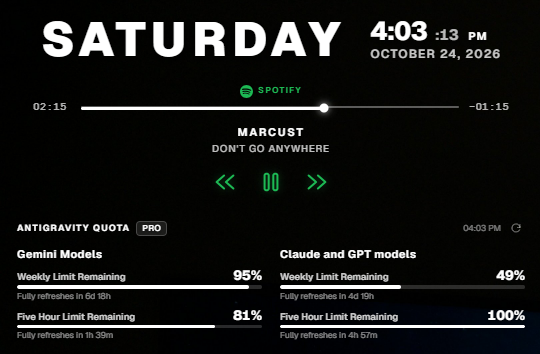

# Quoty

A frameless Windows desktop widget for **Google Antigravity quotas**, **Spotify**, and the clock — inspired by Rainmeter.

<p align="center">
  
</p>

Quoty sits on the desktop like a widget instead of behaving like a normal app window. It stays visible after **Win+D**, survives desktop refreshes, stays out of the taskbar, and can optionally be kept above other windows.

## What it does

- **Desktop clock** — large weekday, time with seconds, and full date.
- **Antigravity quotas** — weekly and five-hour remaining limits for Gemini and Claude/GPT model groups, read from Antigravity's own local language server.
- **Spotify player** — now-playing artist and track, play/pause, previous, and next controls.
- **Desktop-first behavior** — stays on the desktop layer after Win+D and desktop right-click/refresh; can also be set always-on-top.
- **Tray controls** — open settings, refresh quotas, show/hide the widget, toggle always-on-top, or quit.
- **Customization** — system/light/dark theme, widget width, preferred display name, position lock, and start-with-Windows.
- **Local-only data** — no account login, telemetry, analytics, or cloud quota service.

## Requirements

| Requirement | Details |
|---|---|
| OS | Windows 10 or Windows 11, 64-bit |
| WebView2 | Included with Windows 11; the installer downloads it automatically on Windows 10 if missing |
| Antigravity | Required for quota data. Quoty reads from Antigravity's local language server. |
| Spotify | Optional, for the now-playing section and media controls |

## Install

### Installer (recommended)

1. Download the latest `Quoty_0.1.0_x64-setup.exe` from the repository's **Releases** page.
2. Run the installer. It installs per-user, so **no administrator rights are required**.
3. Launch **Quoty** from the Start Menu. It will appear on the desktop and in the system tray.

The installer places the app in:

```text
%LOCALAPPDATA%\Quoty
```

### Unsigned build

This build is **not code-signed**. Windows SmartScreen may show a warning such as **“Windows protected your PC”** or **“Unknown publisher.”**

If you downloaded the file from the official Releases page and the SHA-256 matches, you can continue with:

**More info → Run anyway**

Verify the download against `SHA256SUMS.txt` from the same release:

```powershell
Get-FileHash .\Quoty_0.1.0_x64-setup.exe -Algorithm SHA256
```

### Portable version

A portable `quoty.exe` may also be attached to the release. It runs without installation, but:

- WebView2 must already be installed.
- There is no Start Menu shortcut or uninstaller.
- “Start with Windows” points to wherever the executable currently lives, so don't move it after enabling that setting.

## Using Quoty

### Desktop behavior

Quoty is designed to live on the desktop:

- It is **not** always-on-top by default. Other application windows can cover it, just like a Rainmeter skin.
- It stays visible after **Win+D** and after interacting with the desktop.
- It does not appear in the taskbar.
- Only one copy can run at a time. Launching Quoty again reveals the existing widget and shows a **Quoty is already running.** message.
- Enable **Always on top** in Settings if you want it above normal windows.

### Tray menu

| Action | How |
|---|---|
| Open Settings | Left-click the tray icon, or right-click → **Settings…** |
| Refresh quotas | Tray → **Refresh quotas**, or the refresh icon in the widget |
| Show / hide | Tray → **Show widget** / **Hide widget** |
| Always on top | Tray → **Always on top** |
| Quit | Tray → **Quit Quoty** |

Closing the widget hides it; use the tray icon to bring it back.

### Quotas

Quoty refreshes automatically every **60 seconds** and on demand with the refresh button. It shows the plan badge when Antigravity reports one, along with:

- Weekly limit remaining
- Five-hour limit remaining
- Time until each limit fully refreshes

If Antigravity is closed or its local service is unavailable, Quoty shows an explanation instead of inventing numbers.

### Spotify

When Spotify is running, Quoty reads the artist and track from the Spotify window title and displays them. The controls use Windows media keys:

- Play / pause
- Previous track
- Next track
- Launch Spotify when it isn't running

Spotify does not expose playback position through its window title, so the timeline is an estimate rather than an exact seek control.

## Privacy

Quoty is local-first. It does **not** have an account system, API keys, telemetry, or analytics.

| Data | How it is used | Where it goes |
|---|---|---|
| Antigravity quota data | Displayed in the widget | Read from `127.0.0.1` only; never uploaded |
| Antigravity CSRF token | Authenticates requests to Antigravity's local service | Kept in memory only; never saved or logged |
| Spotify artist / track | Displayed in the player | Read locally from Spotify's window title |
| Preferred display name | Greeting text | WebView local storage on this PC |
| Window position, theme, width, toggles | Restores the widget | `%APPDATA%\com.quoty.widget\settings.json` |
| Telemetry / analytics | None | None |

### How quota discovery works

Quoty looks for Antigravity's local language server process, reads its loopback port and local CSRF token, and calls a small set of quota endpoints on `127.0.0.1`. The HTTP client has proxies disabled, a short timeout, and a response size limit.

The session token is held in memory for the current process only. It is not written to disk, printed to logs, or sent anywhere except Antigravity's local loopback service.

### What Quoty does not do

- It does not read Antigravity credentials or project files from disk.
- It does not send quota, Spotify, or usage data to a remote server.
- It does not run a local web server or accept incoming network connections.
- It does not load remote web content. The WebView is restricted to bundled local assets.

## Security notes

- Quoty runs as the current user and does not request administrator privileges.
- The webview uses a strict content security policy and minimal Tauri capabilities.
- The release is unsigned; see **Unsigned build** above and verify the SHA-256 checksum.
- Download releases only from this repository's **Releases** page. Avoid third-party mirrors.
- If you build from source, you can inspect and compile the exact code yourself.

## Settings and data

| Item | Location |
|---|---|
| Installed application | `%LOCALAPPDATA%\Quoty` |
| Preferences | `%APPDATA%\com.quoty.widget\settings.json` |
| Display name | WebView local storage |
| Start with Windows | `HKCU\Software\Microsoft\Windows\CurrentVersion\Run\Quoty` |

**Start with Windows** is enabled by default and can be disabled in Settings.

## Uninstall

1. Open **Settings → Apps → Installed apps → Quoty** and choose **Uninstall**.
2. Remove the preferences folder if you want a completely clean removal:

```text
%APPDATA%\com.quoty.widget
```

If you enabled **Start with Windows**, turn it off in Settings before uninstalling, or remove the `Quoty` value from:

```text
HKCU\Software\Microsoft\Windows\CurrentVersion\Run
```

## Build from source

### Prerequisites

- Windows 10/11, 64-bit
- Node.js 20.19+ or 22.12+ (22 LTS recommended)
- Rust 1.90+
- Visual Studio Build Tools with the **Desktop development with C++** workload
- Windows 10/11 SDK
- WebView2 runtime

### Development

```powershell
npm install
npm run tauri dev
```

### Production installer

```powershell
npm run tauri build
```

The installer is written to:

```text
src-tauri\target\release\bundle\nsis\Quoty_0.1.0_x64-setup.exe
```

### Tests

```powershell
npm test
cargo test --manifest-path src-tauri/Cargo.toml
```

## Troubleshooting

| Problem | Fix |
|---|---|
| “Antigravity isn't running” | Open Antigravity IDE and sign in. Quoty needs its local language server. |
| “Session not accepted” | Restart Antigravity so it issues a new local session token, then refresh. |
| “Quota API unavailable” | Update Antigravity. Its quota endpoints may have changed. |
| Widget is hidden | Tray icon → **Show widget**. |
| Spotify isn't showing a track | Start playback in the Spotify desktop app. Quoty reads the window title in the form `Artist - Track`. |
| Widget is behind other windows | This is the default desktop behavior. Enable **Always on top** in Settings to keep it above them. |
| SmartScreen warning | The build is unsigned. Verify the SHA-256 and use **More info → Run anyway**. |
| Start with Windows isn't working | Toggle it off and back on in Settings, or check the `Quoty` value under `HKCU\Software\Microsoft\Windows\CurrentVersion\Run`. |

## Project structure

```text
src/                     React frontend
src-tauri/src/           Rust backend
  desktop.rs             Windows desktop-layer and Win+D behavior
  quota/                 Antigravity local-service discovery and client
  spotify.rs             Spotify detection and media-key controls
docs/                    Screenshots and documentation assets
```

## Credits

- Built with [Tauri](https://tauri.app/), [React](https://react.dev/), and [Vite](https://vite.dev/).
- Uses the [Geist](https://vercel.com/font) typeface, licensed under the SIL Open Font License.

Quoty is not affiliated with Google, Antigravity, or Spotify.
